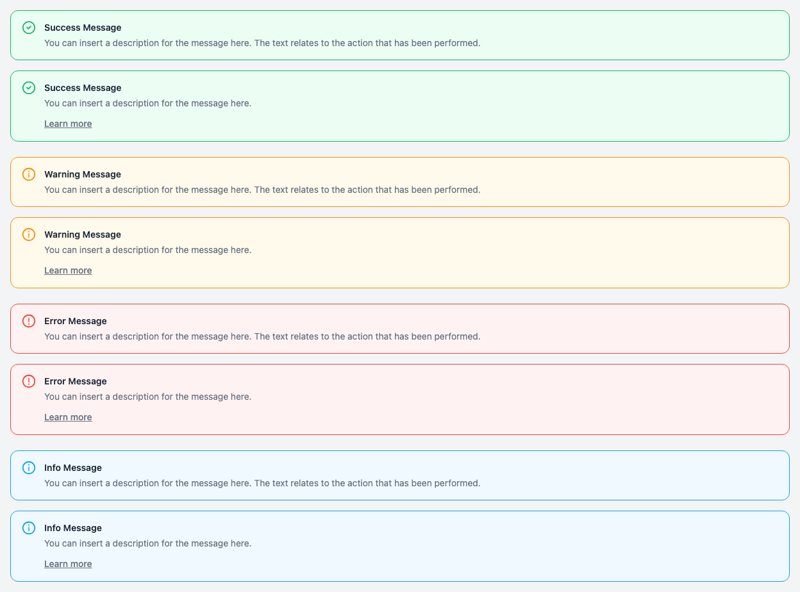
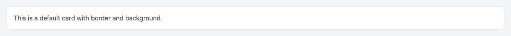
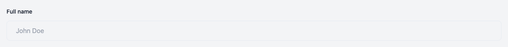
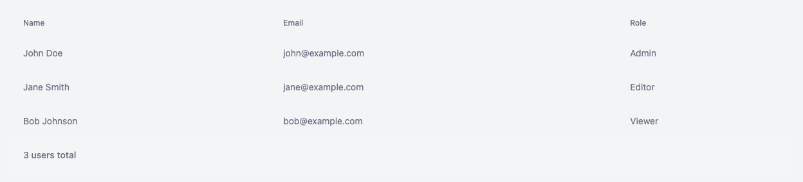
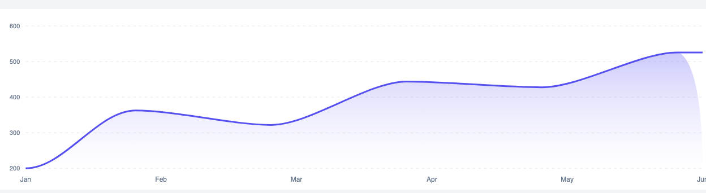
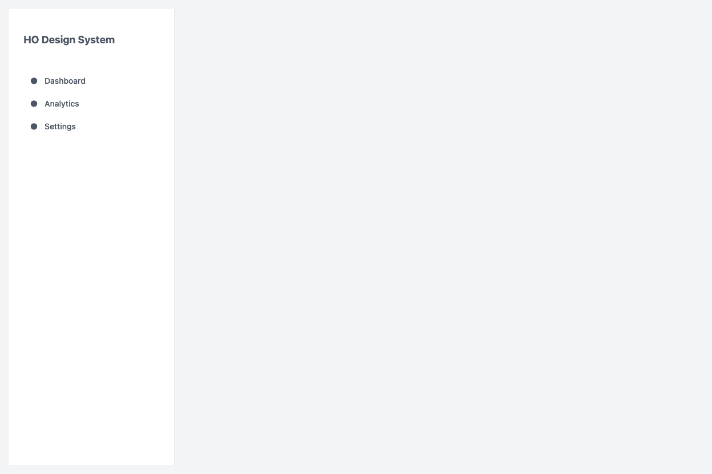
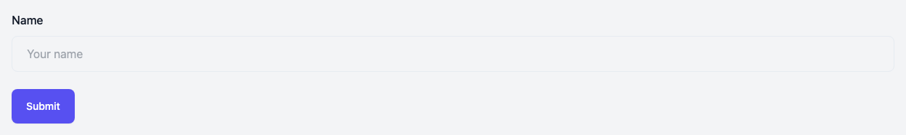

# HO Design System

> Start from architecture, not boilerplate.

[](https://github.com/HugoOliveiraThor/holiveira-design-system/actions/workflows/ci.yml)
[](https://github.com/HugoOliveiraThor/holiveira-design-system/actions/workflows/pages.yml)
[](https://opensource.org/licenses/MIT)

## Live

- **Storybook** — component documentation:
  <https://hugooliveirathor.github.io/holiveira-design-system/>
- **Getting Started** — install and first steps:
  <https://hugooliveirathor.github.io/holiveira-design-system/?path=/docs/getting-started--docs>
- **Playground** — full product screens composed from the packages:
  <https://hugooliveirathor.github.io/holiveira-design-system/playground/>

## What is HO Design System

HO Design System is a composable, engineering-first Design System for professional web applications.
It is a monorepo of independent npm packages under the `@ho-dev/*` namespace — install only what you
use, nothing more.

The project is React-first and Next.js-optimized, with built-in professional application
infrastructure: authentication, authorization with RBAC, forms with validation, charting, theming
with dark mode, and application layouts.

Every decision is documented in specifications, ADRs, and contracts. Public APIs are governed by
explicit rules. Standards are intentional, not accidental. HO Design System is not defined by
feature count — it is defined by engineering quality.

HO Design System is not a template, a starter kit, or a copy-paste component library. It is a
long-term engineering investment designed for a 10+ year lifecycle.

## Status

> **Pre-release.** The current version is `0.2.0`, not yet published to npm. Until the first
> release, use this repository and the
> [playground](https://hugooliveirathor.github.io/holiveira-design-system/playground/) — the
> `pnpm add` commands below apply after publishing.

## Why HO Exists

HO Design System was born from my own need. Across multiple real-world professional applications, I
kept rebuilding the same architectural foundation from scratch — project structure, authentication,
layouts, forms, design tokens, themes, infrastructure, development standards, and governance. None
of that was the product; all of it was the prerequisite. HO exists to stop paying that tax on every
project.

The market is full of excellent designs. Rather than start from zero, I studied what the best
existing design systems do well and shaped HO around the scenarios I actually face in production —
more specific, more opinionated, tailored to how I build.

I did not build this for an audience. I built it for myself, so every new project starts from
**architecture instead of boilerplate**. If it helps other developers do the same, even better.

## Components

| Button                                                             | Alert                                                            | ButtonGroup                                                                   |
| ------------------------------------------------------------------ | ---------------------------------------------------------------- | ----------------------------------------------------------------------------- |
|  |  |  |

| Card                                                           | InputGroup                                                                  | Table                                                            |
| -------------------------------------------------------------- | --------------------------------------------------------------------------- | ---------------------------------------------------------------- |
|  |  |  |

| Dropdown                                                               | AreaChart                                                                 | PieChart                                                                |
| ---------------------------------------------------------------------- | ------------------------------------------------------------------------- | ----------------------------------------------------------------------- |
|  |  |  |

| Sidebar                                                              | Form                                                           |
| -------------------------------------------------------------------- | -------------------------------------------------------------- |
|  |  |

> Explore all components interactively in
> [Storybook](https://hugooliveirathor.github.io/holiveira-design-system/).

## Ecosystem

### Public Packages

| Package              | Description                                              | Category    |
| -------------------- | -------------------------------------------------------- | ----------- |
| `@ho-dev/types`      | Shared TypeScript type definitions                       | Core        |
| `@ho-dev/config`     | Application configuration utilities                      | Core        |
| `@ho-dev/constants`  | Shared constants and route definitions                   | Core        |
| `@ho-dev/tokens`     | Design token definitions and raw values                  | Foundation  |
| `@ho-dev/utils`      | Utility functions (cn, cva, format, guards)              | Foundation  |
| `@ho-dev/i18n`       | Locale-aware formatting using native Intl APIs           | Foundation  |
| `@ho-dev/eslint`     | ESLint configuration presets                             | Foundation  |
| `@ho-dev/providers`  | Provider composition utility                             | Foundation  |
| `@ho-dev/hooks`      | React hooks (clickOutside, isMobile, focusTrap)          | Primitives  |
| `@ho-dev/icons`      | Tree-shakeable SVG icon components                       | Primitives  |
| `@ho-dev/primitives` | Accessible UI primitives (Button, Table, Dropdown, etc.) | Primitives  |
| `@ho-dev/theme`      | Theme provider with dark mode support                    | Composition |
| `@ho-dev/forms`      | Form system with react-hook-form + Zod validation        | Composition |
| `@ho-dev/charts`     | Chart components wrapping ApexCharts                     | Composition |
| `@ho-dev/layouts`    | Application shell components (Sidebar, Header)           | Composition |
| `@ho-dev/ui`         | Composite UI components (Breadcrumb, Card)               | Composition |

### Private Packages

| Package           | Description                                   |
| ----------------- | --------------------------------------------- |
| `@ho-dev/auth`    | Authentication and authorization (BetterAuth) |
| `@ho-dev/api`     | Typed fetch-based API client                  |
| `@ho-dev/db`      | Prisma ORM client singleton                   |
| `@ho-dev/testing` | Shared testing infrastructure                 |

## Architecture

HO Design System follows a five-level dependency hierarchy. Lower levels never import from higher
levels. Every dependency has a documented owner. Every architectural decision has a written
rationale.

```
Core (Level 0)
  └── Foundation (Level 1)
        └── Primitives (Level 2)
              └── Composition (Level 3)
                    └── Services (Level 4)
```

- **Core** — Type definitions and configuration. Zero runtime dependencies.
- **Foundation** — Utility packages, design tokens, ESLint presets, i18n formatters.
- **Primitives** — Atomic components (Button, Table) and hooks. Building blocks for all higher-level
  components.
- **Composition** — Composite components and application shells (Forms, Charts, Layouts, Theme).
- **Services** — Backend infrastructure (Auth, API client, Database). Private packages.

See [docs/architecture/](docs/architecture/) for specifications, ADRs, and package contracts.

## Quick Start

Requirements: **Node.js 24** (see `.nvmrc`; packages declare `engines.node >= 22`), **pnpm 11.3.0**
(see `packageManager`), and **PostgreSQL** for `db:generate`.

```bash
git clone https://github.com/HugoOliveiraThor/holiveira-design-system.git
cd holiveira-design-system
pnpm install
cp .env.example .env
pnpm run db:generate
pnpm run dev
```

`pnpm run dev` starts Storybook on <http://localhost:6006> and the Playground on
<http://localhost:3000>.

### After the first npm release

```bash
pnpm add @ho-dev/primitives @ho-dev/theme
```

```tsx
import { ThemeProvider } from '@ho-dev/theme';
import { Button } from '@ho-dev/primitives';

function App() {
  return (
    <ThemeProvider>
      <Button variant="primary">Get Started</Button>
    </ThemeProvider>
  );
}
```

## Development

### Commands

| Command                    | Purpose                                            |
| -------------------------- | -------------------------------------------------- |
| `pnpm run all-checks`      | Complete repository validation (all quality gates) |
| `pnpm run dev`             | Storybook (:6006) and Playground (:3000)           |
| `pnpm run dev:storybook`   | Storybook development server only                  |
| `pnpm run build`           | Build all packages                                 |
| `pnpm run build:storybook` | Static Storybook build                             |
| `pnpm run test`            | Run test suite                                     |
| `pnpm run typecheck`       | TypeScript compilation check                       |
| `pnpm run check:docs`      | Validate documentation links                       |
| `pnpm run changeset`       | Record a change for the next release               |

### Toolchain

- **Turbo** — Orchestrates builds with dependency-aware caching. All packages compile via `tsc`.
- **pnpm** — Workspace management with `workspace:*` protocol for inter-package dependencies.
- **Storybook** — Interactive component development and documentation at
  [Storybook](https://hugooliveirathor.github.io/holiveira-design-system/).
- **Changesets** — Independent per-package versioning. Run `pnpm changeset` to record changes.
- **Vitest** — Test runner with jsdom environment and Testing Library integration.

## Releases

Versions are managed with [Changesets](https://github.com/changesets/changesets) — independent
per-package semver. A breaking change in `@ho-dev/charts` does not force a major bump in
`@ho-dev/types`.

Nothing has been published to npm yet; `0.2.0` is the first planned release. The history lives in
[CHANGELOG.md](CHANGELOG.md) and in each package's `CHANGELOG.md`.

Publishing is a manual workflow (`.github/workflows/release.yml`):

1. Contributors run `pnpm changeset` to record changes
2. Run `pnpm changeset version` to apply the pending bumps and update the per-package CHANGELOGs
3. A maintainer dispatches the **Publish** workflow, which runs the publish-time gates
   (`check:publish`, `check:license`, `check:exports`) and then `changeset publish`

> Automated Version PR creation via `changesets/action` is intentionally not enabled yet — the
> current flow keeps a human review gate before publishing. See
> `docs/architecture/ads-010-release.md` for the release architecture.

Releases follow a graduated path: `beta` → `rc` → `latest` (GA).

## Contributing

See [CONTRIBUTING.md](CONTRIBUTING.md) for development setup, coding standards, and the changeset
workflow.

## Community

- [Issues](https://github.com/HugoOliveiraThor/holiveira-design-system/issues) — Bug reports and
  feature requests
- [Storybook](https://hugooliveirathor.github.io/holiveira-design-system/) — Interactive component
  documentation
- [Playground](https://hugooliveirathor.github.io/holiveira-design-system/playground/) — Full
  product screens composed from the packages
- [Changelog](CHANGELOG.md) — Release history
- [Code of Conduct](CODE_OF_CONDUCT.md)
- [Security Policy](SECURITY.md) — Reporting vulnerabilities

## License

[MIT](LICENSE)
